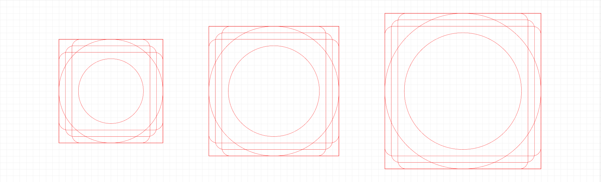
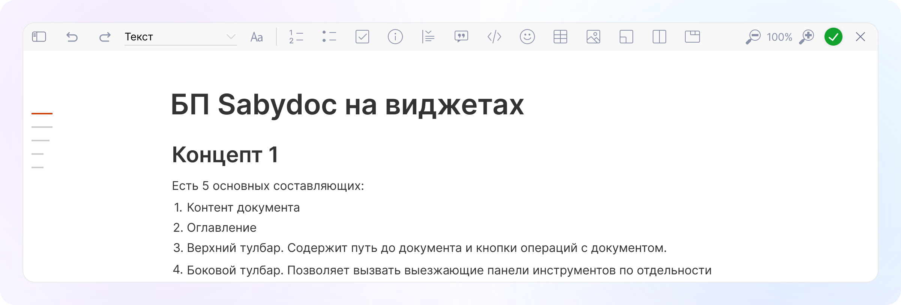
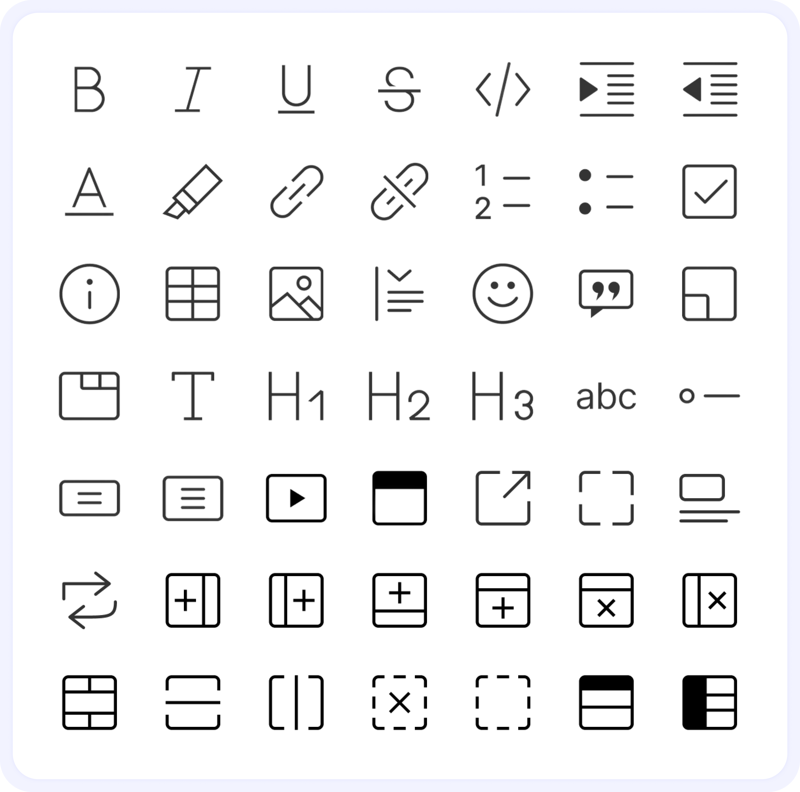

## Задача

В текстовом редакторе использовалось более 60 иконок: ими обозначались виджеты и операции над ними. Их дизайн устарел, а сами иконки различались по визуальному весу, толщине линий и стилю.

Мы поставили перед собой задачу **отрисовать новый набор иконок для текстового редактора**.

## Проработка правил и первые иконки

Когда мы начали работу, стало понятно, что нужен гайд по отрисовке иконок. Он помог бы нам сделать иконки в едином стиле и с равным визуальным весом. До этого в компании такого гайда не было.

Мой лид предложил взять шаблон из Material Design. Мы адаптировали его под наши основные размеры иконок: 16, 20 и 24 px.

Чтобы определиться с визуальным стилем, отрисовали иконки для виджетов текстового редактора. На их примере мы проверили шаблон, скругления и толщину линий.

## Что получилось

Когда мы сформулировали правила и проверили их на иконках виджетов, перешли к остальным. В итоге у нас получилось **почти 50 иконок**. Часть пришлось нарисовать с нуля: для них либо не было подходящих аналогов в дизайн-системе, либо менять существующие аналоги было нецелесообразно.

## Гайд для команды

Чтобы другие дизайнеры могли рисовать иконки в том же стиле и с тем же визуальным весом, мы оформили гайд и предложили его коллегам. Отдел стандартизации утвердил гайд, а отдел обучения включил его в онбординг новых дизайнеров.

Позже мы выпустили новость с советами по отрисовке иконок и их оптимизации перед передачей в разработку.
